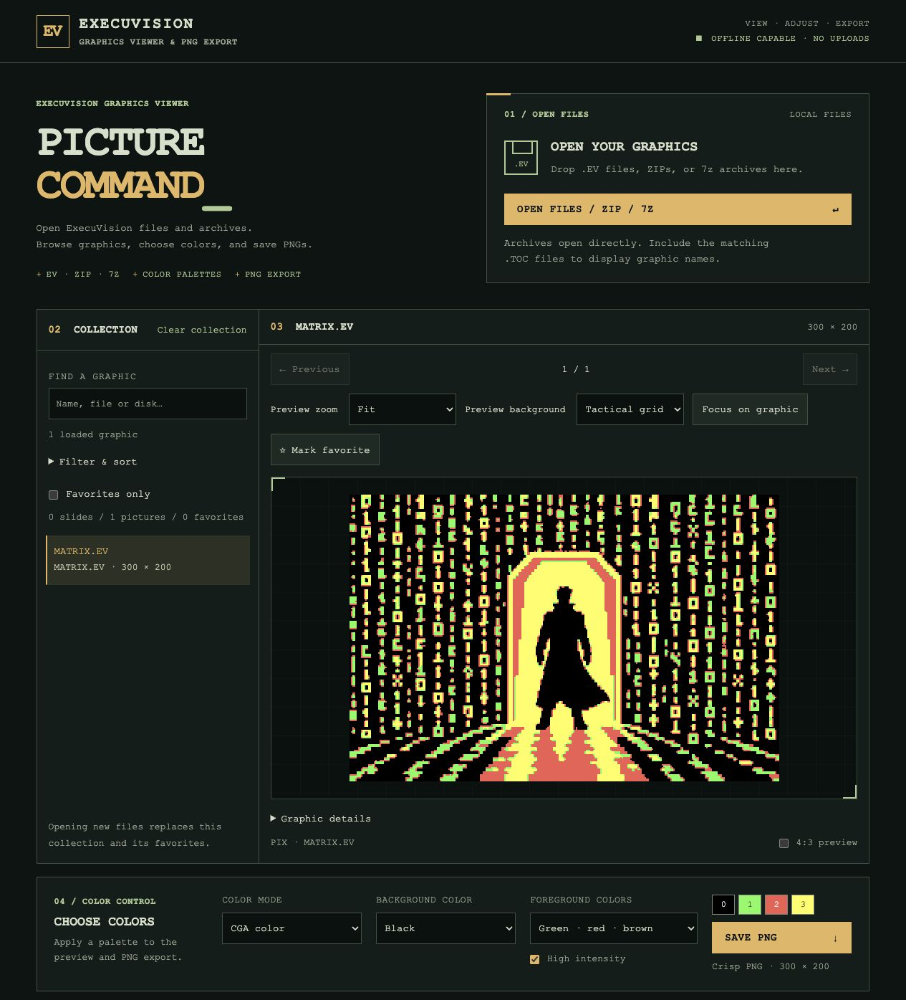
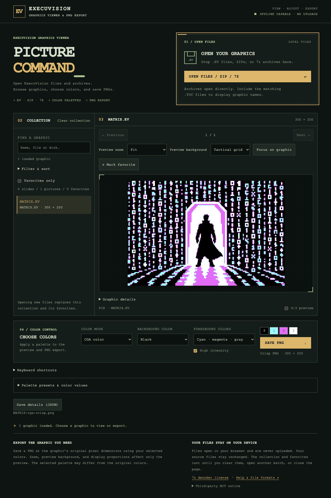
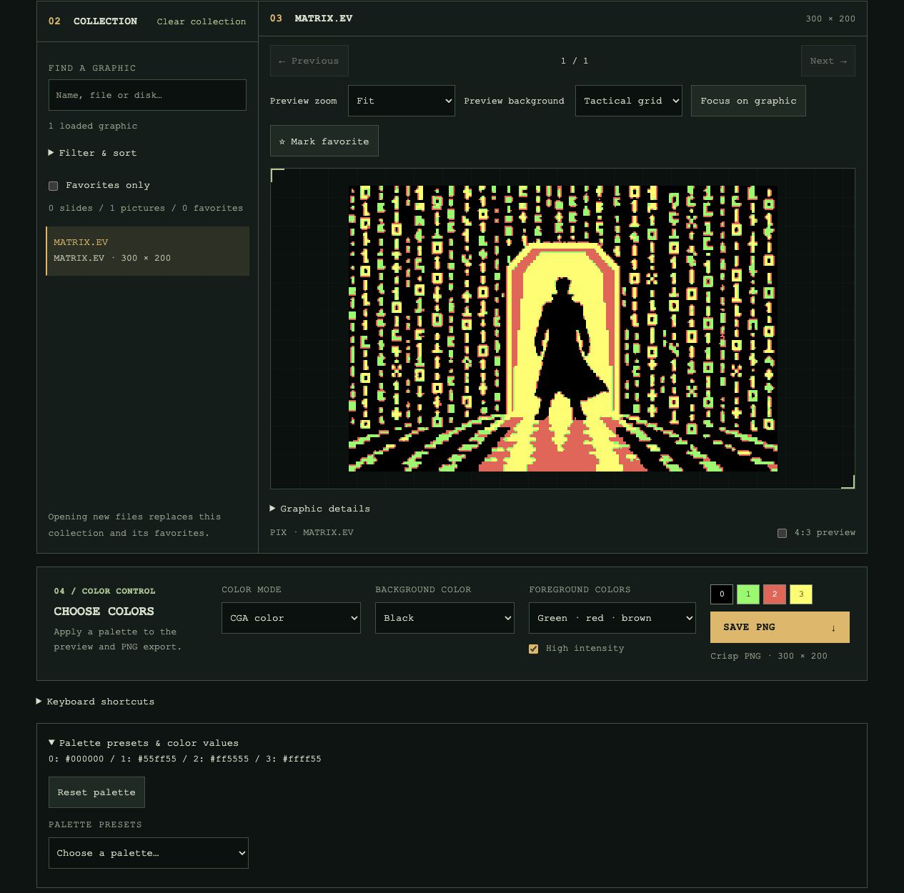
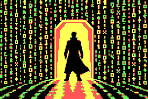

# ExecuVision Picture Command

Open ExecuVision graphics, browse collections, choose colors, and export PNGs—all in your browser.

**[Open the app](https://unamanic.github.io/execuvision-picture-command/)**



## Features

- Open `.EV` files, disk ZIPs, and original `.7z` archives with contained disk ZIPs.
- Search, filter, sort, and mark favorites in a collection.
- Browse with keyboard shortcuts and inspect graphics with zoom and focus view.
- Choose CGA palettes or grayscale and export native-resolution PNGs.
- Save source details and palette values as JSON.

Files are processed on your device. No uploads, account, analytics, or network processing.
Source files stay unchanged; collections and favorites last for the current session.
The walkthrough uses an original AI-generated demo graphic. No historical sample archives or disk images are included.

## Demo walkthrough

Download [MATRIX.EV](https://unamanic.github.io/execuvision-picture-command/demo/MATRIX.EV)
to follow along with this 300 × 200 CGA graphic.

1. **Open the file.** Choose **Open files / ZIP / 7Z** and select `MATRIX.EV`,
   or drag it onto the page. The graphic appears in the collection and preview.
   EV files store pixel indices, so the initial colors use your current palette.



2. **Choose colors.** Expand **Palette presets & color values** and choose
   **Green / red**. This sets CGA palette 0, high intensity, with a black background.
   Use **Preview zoom** or **Focus on graphic** to inspect the pixels.



3. **Export a PNG.** Choose **Save PNG** below the color controls.
   The saved image stays at 300 × 200 pixels, regardless of preview zoom.



## Use locally

Download the self-contained [offline HTML](https://unamanic.github.io/execuvision-picture-command/ExecuVision-Picture-Desk.html)
and open it in a current browser. For controls, supported formats, and limits, see [the usage guide](web/README.md).

## Development

Requires Node.js 22+. There are no package dependencies to install.

```sh
npm test        # Builds the site and runs all tests
npm run preview # Serves dist/ at http://127.0.0.1:8000
```

Use `npm run build` to build without running tests. The build embeds the scripts, styles, and 7z decoder
in `dist/index.html` and creates the downloadable single-file version.
Tests use generated fixtures; private graphics libraries are not required.

GitHub Actions tests and builds pull requests. Pushes to `main` also deploy the
`dist/` artifact to GitHub Pages. Enable **GitHub Actions** as the Pages source
when using this workflow in a fork.

## Software reference

[VCN ExecuVision 1.0 on WinWorld](https://winworldpc.com/product/vcn-execuvision/10)
provides information about the original software and its graphics libraries.

## Inspiration

This project was inspired by [Why Clip Art Was Everywhere... Until It Wasn't](https://www.youtube.com/watch?v=XfLlpxE6AYM)
by Linus Boman.

## Acknowledgments

Thanks to OpenAI Codex for collaborating on the design, implementation, testing,
and documentation of this project.

## License

The original project code is licensed under the [MIT License](LICENSE),
Copyright © 2026 William Witt. Bundled third-party software retains its own licenses; see the notices below.

## Third-party software

See [THIRD_PARTY_NOTICES.md](THIRD_PARTY_NOTICES.md) for the decoder acknowledgments
and licenses. The bundled 7z decoder's corresponding source archives and rebuild
instructions are included in [third_party/](third_party/README.md).
